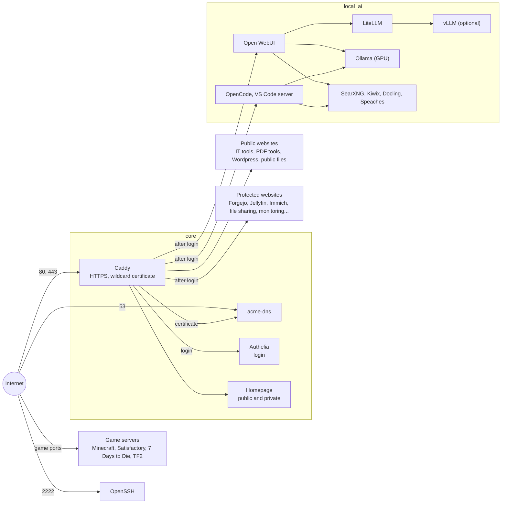

# Infrastructure

_Open source, decentralized and self-hosted infrastructure for many local services and authentication with Authelia._

## Features

- [x] caddy 2 HTTP/S reverse proxy, Let's Encrypt wildcard certificate with acme-dns
- [x] Authelia (SSO / authentication middleware)
- [x] local_ai: Ollama (Vulkan), Open WebUI, LiteLLM, OpenCode, VS Code server, Kiwix, Docling, Kroki, Speaches (voice), vLLM (optional)
- [x] Compiler Explorer
- [x] qbittorrent and transmission (Torrent client/server)
- [x] Docker / docker-compose
- [x] Homepage (Public and private dashboards, services declared by Docker labels)
- [x] SearXNG (Self-hosted search engine, and the web search of local_ai)
- [x] Jellyfin (Eg Netflix, Disney+)
- [x] Immich (Photo and video library, Eg Google Photos)
- [x] Forgejo (Git server, fork of Gitea) and its Actions runner
- [x] Uptime Kuma (Monitoring) and Dozzle (Docker logs)
- [x] Argus (Application update monitoring)
- [x] Renovate (pull requests for new image versions, on GitHub)
- [x] SyncThing (File synchronization)
- [x] Dufs (File server)
- [x] PsiTransfer, ProjectSend, Picoshare (File sharing)
- [x] it-tools, omni-tools and cyberchef (Tools for IT)
- [x] Privatebin
- [x] Memos (Note-taking)
- [x] Stirling PDF and BentoPDF (PDF tools)
- [x] Wordpress (Via FASTCGI/caddy)
- [x] Dependency-Track (SBOM / vulnerability tracking)
- [x] OpenSSH (SFTP / rsync access to the data)
- [x] Restic backups (Caddy, Wordpress, game servers)
- [X] Game (Satisfactory, Minecraft, 7 Days to Die, Team Fortress 2)

## Architecture

A summary, not every service:



## Quick start

```sh
git clone --recurse-submodules --remote-submodules https://github.com/bensuperpc/infrastructure.git
cd infrastructure
make init   # creates infrastructure/.env: secrets, domain, COMPOSE_PROFILES
make up
```

The default `infrastructure/.env` is a local test on `bensuperpc.localhost`: see [Configuration](docs/configuration.md) to go online.

## Documentation

| Page | Content |
| ---- | ------- |
| [Installation](docs/installation.md) | Requirements, ports, start and stop, apps and profiles, Docker networks |
| [Configuration](docs/configuration.md) | `infrastructure/.env`, domain, local testing, wildcard certificate |
| [Domains](docs/domains.md) | Subdomain and access of each service |
| [Services](docs/services.md) | First setup of each service: Authelia, local_ai, Forgejo, OpenSSH... |
| [Maintenance](docs/maintenance.md) | Updates (Renovate), Docker volumes |
| [Sources](docs/sources.md) | Projects and tutorials used |

## License

[License](LICENSE)
