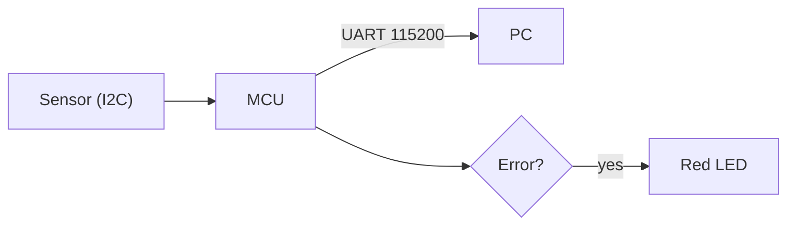
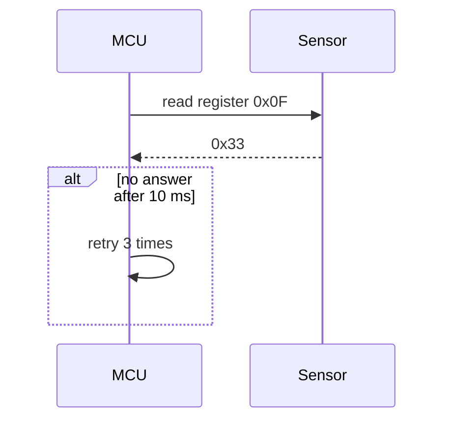

GitHub and GitLab display ```` ```mermaid ```` blocks of Markdown files: in a README or a doc, put the diagram there, not an image. For an image, write a `.mmd` file and render it.

Always check the syntax by rendering, also for a Markdown block (copy it into a temporary `.mmd` file):

```bash
curl -sS --fail-with-body --data-binary @diagram.mmd -o diagram.svg http://kroki:8000/mermaid/svg || head -c 1000 diagram.svg
```

On error, the output file contains the message and the line: fix the diagram and render again. `png` instead of `svg` for a PNG.

## Choose the type

| Need | First line |
| --- | --- |
| Steps, decisions, architecture, data flow | `flowchart TD` (top-down) or `flowchart LR` (left-right) |
| Messages between components, protocols | `sequenceDiagram` |
| Classes and their relations | `classDiagram` |
| State machine | `stateDiagram-v2` |
| Database tables | `erDiagram` |
| Planning | `gantt` |

## Syntax traps

- A node named `end` in lowercase breaks a flowchart: use `End` or `done`.
- Quote text containing `(`, `)`, `[`, `]`, `{`, `}` or `|`: `A["read (file)"]`, `A -->|"call f(x)"| B`.
- `<` and `>` disappear from flowchart labels: write `#lt;` and `#gt;`, as in `A["std::vector#lt;int#gt;"]`.
- `;` breaks a sequence message: write `#59;`.
- Line break in a text: `<br>`.
- Generics in a class diagram: `class Buffer~T~`, `std::vector~int~ data`.
- Short node ids made of letters, digits and `_`, with the text as label: `parser["JSON parser"]`.
- No colors or styles unless asked.

## Examples





## Docs

Mermaid 12.3, one file per diagram type in `/docs/mermaid`: `flowchart.md`, `sequenceDiagram.md`, `classDiagram.md`, `stateDiagram.md`, `entityRelationshipDiagram.md`, `gantt.md`...
